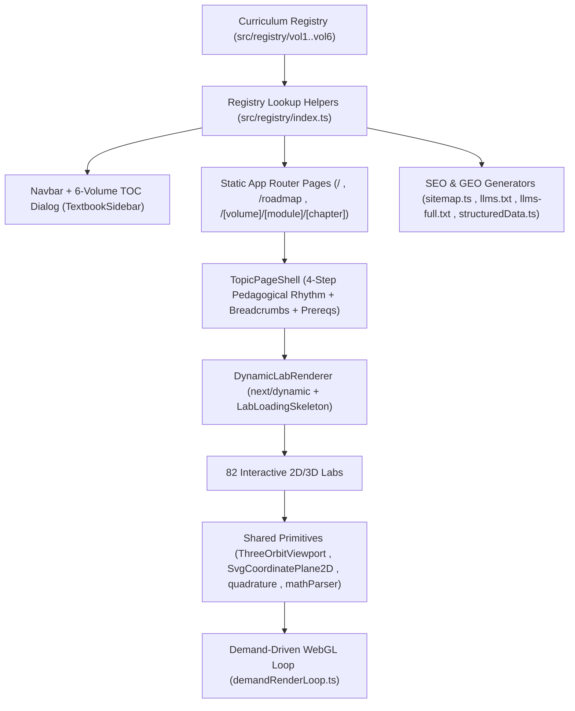

# Architecture Overview — wanna math (`WannaMath` v2.0)

This document explains how **wanna math** (`v2.0`) organizes its **6-Volume, 20-Module, 65-Chapter, 82-Lab** interactive textbook using Next.js 15 App Router, Static Site Generation (`SSG`), a central TypeScript curriculum registry, shared 2D/3D mathematical primitives, and on-demand WebGL rendering.

---

## 1. 4-Tier Pedagogical Taxonomy & Routing

The entire platform mirrors an academic engineering mathematics textbook along a strict 4-tier hierarchy:

```text
Volume (6)  ──▶  Module (20)  ──▶  Chapter (65)  ──▶  Interactive Laboratory (82)
```

| Tier | Route Pattern | Page Implementation | Data Source |
| :--- | :--- | :--- | :--- |
| **Root Overview** | `/` | [`src/app/page.tsx`](../src/app/page.tsx) | `getAllVolumes()`, `MULTIVARIABLE_CALCULUS_TOPICS` |
| **Master Syllabus** | `/roadmap` | [`src/app/roadmap/page.tsx`](../src/app/roadmap/page.tsx) | `getAllVolumes()` |
| **About & Creator** | `/about` | [`src/app/about/page.tsx`](../src/app/about/page.tsx) | Static mission & creator profile |
| **Tier 1: Volume** | `/[volume]` | [`src/app/[volume]/page.tsx`](../src/app/%5Bvolume%5D/page.tsx) | `getVolumeBySlug()` |
| **Tier 2: Module** | `/[volume]/[module]` | [`src/app/[volume]/[module]/page.tsx`](../src/app/%5Bvolume%5D/%5Bmodule%5D/page.tsx) | `getModuleBySlugs()` |
| **Tier 3 & 4: Chapter & Labs** | `/[volume]/[module]/[chapter]` | [`src/app/[volume]/[module]/[chapter]/page.tsx`](../src/app/%5Bvolume%5D/%5Bmodule%5D/%5Bchapter%5D/page.tsx) | `getChapterBySlugs()`, `DynamicLabRenderer` |

Every page across all four tiers is statically pre-rendered at build time via `generateStaticParams` (`113/113` static build outputs including SEO/GEO/PWA routes).

---

## 2. System Data Flow



---

## 3. Typed Curriculum Registry (`src/registry/`)

All syllabus structure, navigation drawers, prerequisite badges, equations, SEO feeds, and lab mappings derive from a single source of truth defined in [`src/registry/types.ts`](../src/registry/types.ts) and aggregated in [`src/registry/index.ts`](../src/registry/index.ts):

- **Volume Manifests:**
  - `src/registry/vol1-single-variable.ts` — Volume I (`single-variable-calculus`)
  - `src/registry/vol2-linear-algebra.ts` — Volume II (`linear-algebra`)
  - `src/registry/vol3-multivariable.ts` — Volume III (`multivariable-calculus`)
  - `src/registry/vol4-differential-equations.ts` — Volume IV (`differential-equations`)
  - `src/registry/vol5-transforms-complex.ts` — Volume V (`transforms-complex-analysis`)
  - `src/registry/vol6-probability-numerical.ts` — Volume VI (`probability-numerical-methods`)
- **Core Interfaces (`src/registry/types.ts`):**
  - `VolumeMetadata`: Volume number (`I`–`VI`), URL slug, Butterfly accent token/hex, description, engineering applications, and `modules[]`.
  - `ModuleMetadata`: Module slug, `numberLabel` (e.g., `3.2`), description, and `chapters[]`.
  - `ChapterMetadata`: Chapter ID, slug, title, subtitle, `status` (`"published" | "in-progress" | "planned"`), `estimatedMinutes`, `prerequisites`, `keyEquationsLatex`, `labs[]`, optional `pedagogicalRhythm`, and optional `subParent` grouping (used to nest chapters `3.1.9`–`3.1.11` under a *Differential Equations* sub-parent inside Differential Calculus).
  - `LabMetadata`: Lab ID, slug, title, `componentKey` matching `LAB_COMPONENTS` in `DynamicLabRenderer.tsx`, summary, optional `formulaLatex`, and `dimensionBadge`.
- **Exported Helpers (`src/registry/index.ts`):**
  - `getAllVolumes()`, `getTocVolumes()`, `getVolumeBySlug()`, `getModuleBySlugs()`, `getChapterRoute()`, `getAllResolvedChapters()`, `getChapterBySlugs()`, `getChapterById()`, and `getAdjacentChapters()`.
- **v1.0 Compatibility Layer:** `src/registry/curriculum.ts` exports `SEMANTIC_MATH_PALETTE` and legacy topic helpers retained cleanly for homepage highlights and legacy `/calculus/*` fallback routes.

---

## 4. Layout, Navigation & Pedagogical Chapter Shell

1. **Root Shell ([`src/app/layout.tsx`](../src/app/layout.tsx)):**
   - Loads `Newsreader` (`--font-serif`), `IBM_Plex_Sans` (`--font-sans`), and `JetBrains_Mono` (`--font-mono`) via `next/font/google` with `display: "swap"`.
   - Injects `<meta name="color-scheme" content="light dark" />` plus an inline pre-paint script synchronizing `localStorage.getItem("color-scheme")` so the selected Light or Dark mode applies immediately without flash of wrong theme.
   - Wraps pages with `<Navbar tocVolumes={tocVolumes} />`, `<main className="flex-1">`, and `<Footer />`.
2. **Global Header & Drawer ([`Navbar.tsx`](../src/components/layout/Navbar.tsx), [`TextbookSidebar.tsx`](../src/components/layout/TextbookSidebar.tsx)):**
   - Brand lockup (`∬ wanna math` + tagline `"Math ain't scary (not anymore)"`), navigation links, Light/Dark switcher (`"Drafting Dark"` / `"Reading Light"`), and a native `<dialog>` 6-volume collapsible Table of Contents drawer (`getTocVolumes()`) that automatically closes on route change or Escape/backdrop click.
3. **Chapter Frame ([`TopicPageShell.tsx`](../src/components/layout/TopicPageShell.tsx)):**
   - 4-tier Breadcrumb navigation (`wanna math / Volume / Module / Chapter`), Dimension & Study-Time badges, non-wrapping Prerequisite Chips bar, Academic Hero header, Governing Mathematical Formulation (`KaTeXMath` cards), **4-Step Pedagogical Chapter Rhythm** *(1. Core Geometric Question → 2. Interactive Discovery → 3. Symbolic Formalization → 4. Edge Cases & Next-Chapter Bridge)*, quick Lab Jump bar, Interactive Laboratory viewports, and Previous/Next chapter navigation.

---

## 5. Legacy Redirects & Compatibility Fallbacks

When the v1.0 site migrated to the 6-volume v2.0 structure, permanent redirects (`permanent: true`) were configured in [`next.config.ts`](../next.config.ts):

| Legacy Source Pattern | Canonical Destination |
| :--- | :--- |
| `/calculus` | `/multivariable-calculus` |
| `/calculus/:slug` | `/multivariable-calculus/integral-calculus/:slug` |
| `/multivariable-calculus/multiple-integrals` | `/multivariable-calculus/integral-calculus` |
| `/multivariable-calculus/multiple-integrals/:slug` | `/multivariable-calculus/integral-calculus/:slug` |
| `/multivariable-calculus/multivariable-differentiation` | `/multivariable-calculus/differential-calculus` |
| `/multivariable-calculus/multivariable-differentiation/:slug` | `/multivariable-calculus/differential-calculus/:slug` |

Static fallback routes under `src/app/calculus/` (`page.tsx`, `double-integrals`, `triple-integrals`, `coordinate-systems`, `jacobians`) also remain valid static build pages.

---

## 6. Code-Splitting & Lab Dispatching

To keep initial JavaScript minimal on landing and non-WebGL routes:

- **Landing Page Preview:** [`HeroIntegralPreviewLoader.tsx`](../src/components/visualizations/HeroIntegralPreviewLoader.tsx) wraps `HeroIntegralPreview` with `next/dynamic` and renders [`LabLoadingSkeleton.tsx`](../src/components/visualizations/LabLoadingSkeleton.tsx) during hydration; `HeroIntegralPreview` itself defers loading `three` and `OrbitControls` inside [`HeroIntegral3DViewport.tsx`](../src/components/visualizations/HeroIntegral3DViewport.tsx) until after first paint or user pointer interaction.
- **Chapter Laboratories:** [`DynamicLabRenderer.tsx`](../src/components/visualizations/DynamicLabRenderer.tsx) registers all **82 unique lab component keys** (`LAB_COMPONENTS`) behind `next/dynamic` with a shared geometric loading skeleton (`LabLoadingSkeleton`). Only the JavaScript chunk for the active chapter's lab(s) is fetched when visiting a chapter route.
